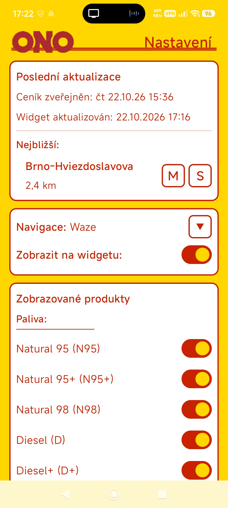
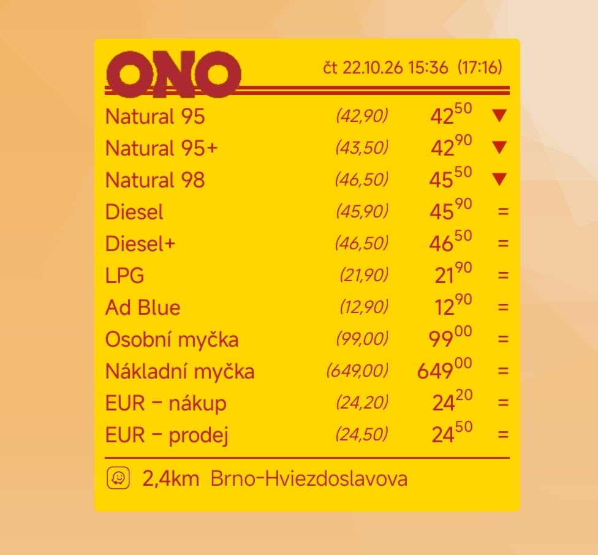
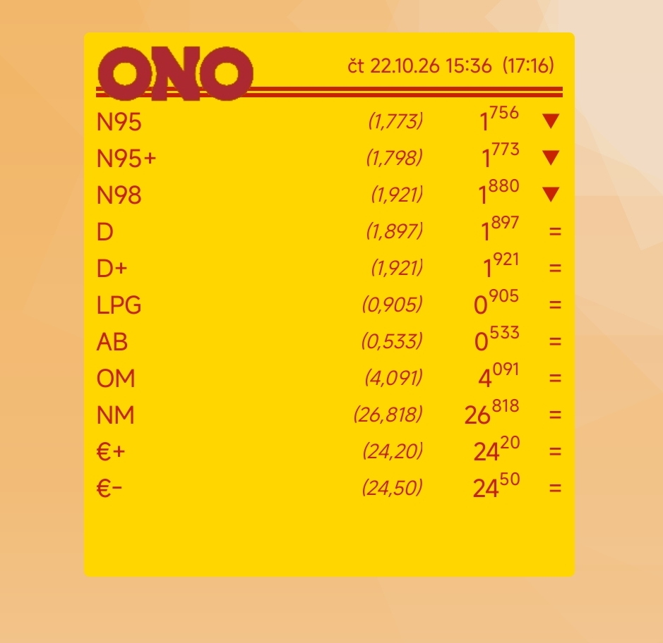
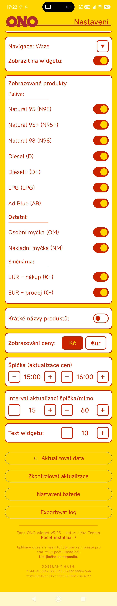

# ⛽ Tank ONO Widget pro Android

Elegantní a rychlý widget pro plochu vašeho telefonu, který vám vždy ukáže aktuální ceny pohonných hmot na čerpacích stanicích **Tank ONO**. Už nikdy nemusíte otevírat prohlížeč, abyste zjistili, kolik dnes stojí benzín nebo nafta.

## ✨ Hlavní funkce

* **Aktuální ceny:** Přehledný seznam paliv (Natural 95, Nafta, LPG, AdBlue) a doplňkových služeb (mytí, směnárna).
* **Nejbližší stanice:** Widget dokáže zobrazit vaši nejbližší čerpací stanici včetně vzdálenosti.
* **Rychlá navigace:** Kliknutím na nejbližší stanici ve widgetu se okamžitě spustí navigace (Waze, Mapy.cz, Google Maps).
* **Tmavý režim:** Widget se automaticky přizpůsobí systémovému tmavému/světlému režimu.
* **Přizpůsobení:** Možnost vybrat si, které produkty se mají zobrazovat, velikost písma a měnu (Kč / €).
* **Sledování trendů:** Pokud Tank ONO zveřejní nový ceník, widget ukáže šipku nahoru/dolů podle změny ceny.
* **Automatická aktualizace:** Data se aktualizují na pozadí přes WorkManager.

## 📸 Screenshoty

<table align="center" border="0">
  <tr>
    <td align="center" valign="top">
        
        
      
    </td>
    <td align="center" valign="top">
      
    </td>
  </tr>
</table>

## 📥 Instalace

Aplikace není dostupná na Google Play, distribuuje se přímo jako instalační soubor (APK).

1. Přejděte do sekce **[Releases](../../releases)** v tomto repozitáři.
2. Stáhněte si nejnovější soubor `TankONO_widget.apk`.
3. Otevřete stažený soubor v telefonu.
4. Android si vyžádá povolení k instalaci z neznámých zdrojů (protože nejde o Google Play). Toto povolení udělte.
5. Nainstalujte aplikaci, přidejte si widget na plochu a máte hotovo!

## 🔒 Soukromí a data

Aplikace klade důraz na soukromí. Při prvním spuštění odešle pouze **anonymní hash vašeho zařízení** (SHA-256), a to výhradně pro orientační statistiku počtu instalací. 
**Neodesílá žádná osobní data, polohu ani identitu.** Poloha je zpracovávána výhradně lokálně ve vašem zařízení pro účely zobrazení nejbližší stanice.

## 🛠️ Pro vývojáře (Technologie)

Projekt je plně open-source. Pokud chcete přispět, nahlásit chybu nebo si aplikaci zkompilovat sami, zde jsou detaily:

* **Jazyk:** Kotlin
* **UI:** Jetpack Compose (nastavení), RemoteViews (widget)
* **Architektura:** MVVM, DataStore, Room (pro seznam stanic)
* **Síťová vrstva:** Jsoup (scraping dat z webu Tank ONO)
* **CI/CD:** GitHub Actions (automatický build a release)

## 🤖 O projektu a využití AI

Tento projekt byl **od naprostého začátku až po finální vydání vytvořen ve spolupráci s umělou inteligencí**. 

Veškerý kód (Kotlin, Jetpack Compose, XML), návrh architektury, logika scrapování dat i nastavení CI/CD pipeline na GitHubu vznikaly v dialogu s AI. Konkrétně se jedná o model **Google Gemini**, který sloužil jako pair-programmer od prvních řádků kódu až po řešení těch nejzapeklitějších bugů s widgety. 

Tento projekt je důkazem, že díky moderním nástrojům dokáže i běžný uživatel bez hlubokých znalostí programování vytvořit stabilní a plnohodnotnou aplikaci.

**Tento projekt není nijak spojen se společností Tank ONO, s.r.o. Data jsou čerpána z veřejně dostupných webových stránek.**

*Autor: Jirka Zeman & Google Gemini*
